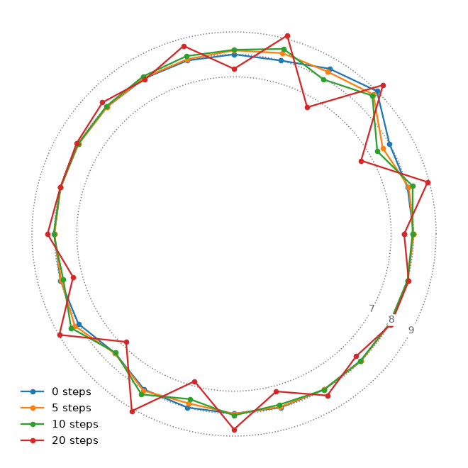
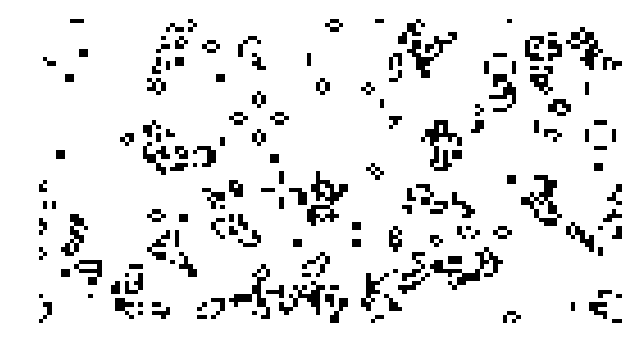
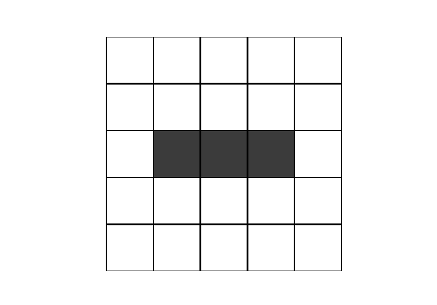
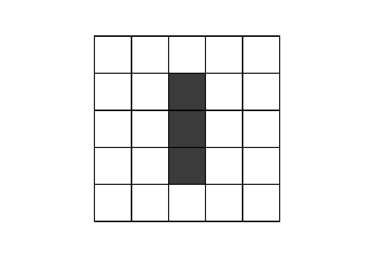
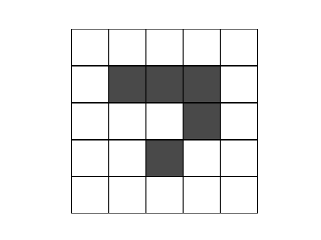
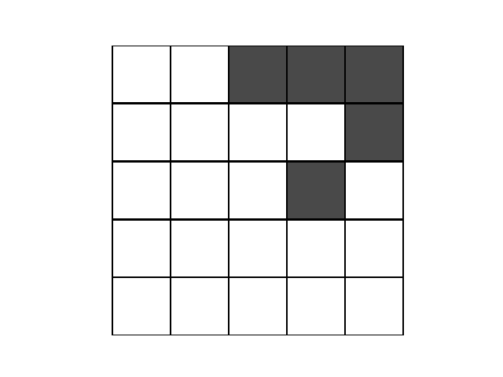

# Coding challenge: cellular automata (specification)

This document specifies what to implement. The [README](README.md) explains how the day runs.

**Contents:** [What to implement](#what-to-implement) ·
[Requirements for all functions](#requirements-for-all-functions) · [Lorenz 96](#lorenz-96) ·
[Conway's Game of Life](#conways-game-of-life) · [Testing your code](#testing-your-code) ·
[How your code is checked](#how-your-code-is-checked) · [Where the course helps](#where-the-course-helps) ·
[Further reading](#further-reading)

## What to implement

Cellular automata are models made of a lattice of cells, each in a given state, together with a set of rules for how
those states evolve in time based on their own state and those of their neighbours. You'll implement two:

- the **Lorenz 96** system, a toy model of atmospheric dynamics due to Ed Lorenz;
- **Conway's Game of Life**, with three extensions: periodic boundaries, two colours, and 3D.

Your module, `automata.py` (and later `automata_updated.py`), must provide two functions:

| Function | What it does |
|---|---|
| `lorenz96(initial_state, nsteps, constants=(1/101, 100, 8))` | `nsteps` steps of the Lorenz 96 update ([Lorenz 96](#lorenz-96)) |
| `life(initial_state, nsteps, rules="basic", periodic=False)` | `nsteps` steps of the Game of Life, where `rules` is `"basic"`, `"2colour"` or `"3d"` ([Conway's Game of Life](#conways-game-of-life)) |

Aim to get `lorenz96` and the basic Game of Life working first; then work through the extensions.

## Requirements for all functions

- **Inputs:** `initial_state` may be a list (or a list of lists), a tuple or a NumPy array. Your functions must not
  modify it (Lecture 2, *Array copies*).
- **Outputs:** a *new* NumPy array of the same shape as `initial_state`:
  - `lorenz96`: floats (`float64`), even if the input is made of integers;
  - `life` with `rules="basic"` or `"3d"`: 0s and 1s (integers, or booleans if the input was boolean);
  - `life` with `rules="2colour"`: the integers −1, 0 and +1.
- **Steps:** each step updates every cell at once, using only the values from the previous step (so don't overwrite
  values you still need). `nsteps=0` returns the starting state unchanged.
- **Grids** need not be square (or cubic).
- **Boundaries** (`life` only): with `periodic=False`, cells beyond the edge of the grid count as dead. With
  `periodic=True`, the grid wraps round in every direction, so a cell on an edge has neighbours on the opposite edge
  (and a corner cell has neighbours in the other three corners).
- **Unknown `rules`:** raise a `ValueError` (a nice one to test with `pytest.raises`, Lecture 4).
- **Imports:** the Python standard library, `numpy`, `scipy` and `matplotlib` only.
- **Nothing runs on import:** put any plotting or experiments under `if __name__ == "__main__":`.
- **Style:** `flake8`, with its default settings (79-character lines), should report nothing (Lecture 4, *Fast
  static analysis*).
- **Speed:** large grids must run in a reasonable time; see [How your code is checked](#how-your-code-is-checked).

## Lorenz 96

This is an automaton based on a toy model of weather patterns that Ed Lorenz (who also developed a more famous model,
influential in the early study of chaos) published in 1996, hence the name.

We have $N$ cells, each holding a real number $x_i$, $i = 1, \ldots, N$. From step $T$ to step $T+1$, every cell is
updated by

$$
x_i^{(T+1)} = \alpha\left(\beta x_i^{(T)} + \left(x_{i-2}^{(T)} - x_{i+1}^{(T)}\right) x_{i-1}^{(T)} + \gamma\right),
$$

where $\alpha$, $\beta$ and $\gamma$ are real constants. The boundaries are **periodic**: indices wrap round, so
$x_0 = x_N$, $x_{-1} = x_{N-1}$ and $x_{N+1} = x_1$. (This makes it natural to plot the cells round a circle: see the
figure below.)

> **Note:** the bracket $\left(x_{i-2} - x_{i+1}\right)$ is the reverse of the form you'll find in most references
> (and the form AI tools tend to "correct" it to). Implement it exactly as written here.

The `constants` argument gives $(\alpha, \beta, \gamma)$, in that order. With the defaults, $\alpha = 1/101$,
$\beta = 100$ and $\gamma = 8$, there are some simple cases you can work out by hand (and use as tests; compare
floating-point results with a tolerance, e.g. `np.testing.assert_allclose`: Lecture 4, *Checking floating-point
results and exceptions*):

- every cell 8: a steady state, so every cell stays at 8;
- every cell 7: after one step, every cell is $708/101 \approx 7.0099$;
- one cell `x[i] = 9`, all the others 8: after one step, `x[i-1]` is $800/101$, `x[i]` is $908/101$ and `x[i+2]` is
  $816/101$, and every other cell is still 8. Try it with `i = 0` and `i = N - 1` to check the wrap-around.

<p align="center"></p>
<p align="center"><em>24 cells round a circle (cell i at angle 2πi/N, radius x<sub>i</sub>), starting at 8 with three
cells nudged, after 0, 5, 10 and 20 steps. The dotted circles mark 7, 8 and 9.</em></p>

Calling it:

```python
import numpy as np
import automata

rng = np.random.default_rng(42)  # Lecture 2, Random number generation
x = 8 + rng.random(16)
y = automata.lorenz96(x, 10)
y2 = automata.lorenz96(x, 10, constants=(1/201, 200, 5))
```

## Conway's Game of Life

<p align="center"></p>

The Game of Life is a 2D cellular automaton devised by the British mathematician John Horton Conway in 1970. Each cell
is either **alive** or **dead**, and has 8 neighbours (including the diagonals). At each step, every cell's new state
depends only on its own state and its neighbours' states at the previous step.

### Basic rules (`rules="basic"`)

For living cells:

- a living cell with 0 or 1 live neighbours dies (of loneliness);
- a living cell with 2 or 3 live neighbours survives to the next step;
- a living cell with 4 or more live neighbours dies (of overcrowding).

For dead cells:

- a dead cell with exactly 3 live neighbours becomes alive;
- otherwise it stays dead.

### Extension 1: periodic boundaries (`periodic=True`)

The grid wraps round in both directions, as though it were surrounded on all sides (including diagonally) by exact
copies of itself. The rules are unchanged. All three versions of the game (basic, two-colour and 3D) must support both
boundary types.

### Extension 2: two colours (`rules="2colour"`)

There are now two "living" states, coded as **+1** and **−1** (think of them as red and blue), with **0** for dead:

- a living cell with 0 or 1 live neighbours (of either colour) dies;
- a living cell with 2 or 3 live neighbours (of either colour) survives, and keeps its colour;
- a living cell with 4 or more live neighbours (of either colour) dies;
- a dead cell with exactly 3 live neighbours becomes alive, with the colour of the majority of those three (with
  three neighbours there's always a majority);
- otherwise a dead cell stays dead.

Ignoring colour, the two-colour game behaves exactly like the basic game.

### Extension 3: 3D (`rules="3d"`)

The grid is now three-dimensional, and each cell has 26 neighbours: every cell that shares a face, an edge or a corner
with it. With so many neighbours we can't keep the same rules. Here:

- a living cell with 5 or 6 live neighbours survives;
- a dead cell with exactly 4 live neighbours becomes alive;
- every other cell dies, or stays dead.

(Bays, in the further reading, discusses other 3D rules; implement the one given here.)

### Calling it

```python
import numpy as np
import automata

rng = np.random.default_rng(42)

X = rng.random((16, 16)) < 0.3                # about 30% of cells alive
Z = automata.life(X, 10)                      # basic rules, dead edges
Z = automata.life(X, 10, periodic=True)       # basic rules, periodic

C = rng.integers(-1, 2, size=(16, 16))        # -1, 0 and +1
Z = automata.life(C, 10, rules="2colour")

X3 = rng.random((16, 16, 16)) < 0.2           # 3D: about 20% alive
Z = automata.life(X3, 10, rules="3d", periodic=True)
```

### Patterns that help with testing

Some starting patterns stay the same or repeat after a few steps, which makes them good test cases:

- **still lifes** never change: e.g. a 2×2 *block*;
- the **blinker** (three cells in a line) flips between horizontal and vertical every step:

  <p align="center">
  &nbsp;⇒&nbsp; </p>

- the **glider** moves diagonally: every 4 steps it reappears one row up and one column to the right (with row 0 at
  the top, as `print` shows an array):

  <p align="center">
  &nbsp;⇒ 4 steps ⇒&nbsp; </p>

The images show part of a larger grid. Periodic boundaries can be tested with a glider that crosses an edge, or a
blinker split across one. Any basic pattern behaves the same in the two-colour game if you ignore colour, and
two-colour blinkers and gliders are easy to build. We'll leave you to devise a test case for 3D!

## Testing your code

The repository comes with a few tests in `tests/test_automata.py`. From the top folder of your repository:

```bash
pytest tests/        # tests automata.py (the base version)
pytest -U tests/     # tests automata_updated.py (the AI-updated version)
```

Add your own tests to `tests/test_automata.py` as you go: they help you get your functions working, and keep them
working. Lecture 4 covers what you need: *Testing*, *Organising/grouping tests*, *Useful `pytest`
command-line options* (`-x`, `-k`, `--pdb`) and *The `doctest` module* (`pytest --doctest-modules automata.py` runs the
examples in your docstrings). When a test fails, reduce it to a *minimal failing example* and use the debugger
(Lecture 4, *Minimum failing examples* and *Using the Python debugger*).

## How your code is checked

After the day, both of your files are run through a larger set of hidden tests, in an environment matching `mpm2026`:

- **correctness:** known patterns, the hand-worked cases above, and random grids compared with a reference solution;
- **the requirements** in [Requirements for all functions](#requirements-for-all-functions) (inputs not modified, return
  types, `nsteps=0`, non-square grids, both boundary types, ...);
- **style:** `flake8` with its default settings, on each file;
- **speed:** large grids, 1024×1024 in 2D for up to 60 steps and 101×101×101 in 3D for up to 40 steps, must each
  finish within 30 seconds (every other test within 10 seconds). A vectorised NumPy solution takes about a second; a
  cell-by-cell Python loop takes minutes. Time your own code with `%timeit` (Lecture 3).

You'll then get automatically generated feedback as an issue in your repository, by Monday.

## Where the course helps

| For | See |
|---|---|
| Committing and pushing your work | Lecture 1, *`git` and `GitHub` basics* |
| Not modifying the input | Lecture 2, *Array copies* and *Views from slices* |
| Counting neighbours without looping over cells | Lecture 2, *Accessing arrays*, *Views from slices*, *Vectorization and operations on arrays* and *Logical expressions and boolean masks*; also look up `np.roll` and `np.pad` with `help()` |
| Random starting grids | Lecture 2, *Random number generation* |
| Making it fast, and comparing your two versions | Lecture 3, `%timeit`, `cProfile` (`%prun`), `line_profiler`, *Big O* and *Vectorisation and SIMD in NumPy* |
| Writing tests; comparing floats | Lecture 4, *Testing* and *Checking floating-point results and exceptions* |
| Code style | Lecture 4, *Fast static analysis* |
| When something doesn't work | Lecture 4, *Minimum failing examples* and *Using the Python debugger* |

The lecture notes are in the module repository, `ese-ada-lovelace-2026/modern-programming-methods`.

## Further reading

- The history and mathematics of the Lorenz 96 system: van Kekem, *Dynamics of the Lorenz 96 model*,
  <https://pure.rug.nl/ws/portalfiles/portal/65106850/1_Introduction.pdf>
- The original article on Life: Gardner, *The fantastic combinations of John Conway's new solitaire game "life"*,
  Scientific American (1970), <https://web.stanford.edu/class/sts145/Library/life.pdf>
- Possible rules for 3D Life: Bays, *Candidates for the Game of Life in Three Dimensions*, Complex Systems (1987),
  <https://content.wolfram.com/sites/13/2018/02/01-3-1.pdf>
- Many more patterns: <https://en.wikipedia.org/wiki/Conway%27s_Game_of_Life>
